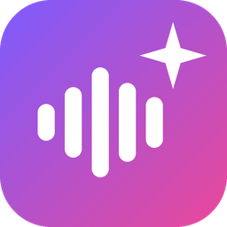

<p align="center"></p>

<h1 align="center">Atelier</h1>

<p align="center">
  Transcription audio avec dictaphone, mise en page de notes et détourage d'images, réunis dans une seule application.<br>
  <b>100 % local : rien ne quitte ton ordinateur.</b>
</p>

<p align="center">
  <a href="https://github.com/Kilian-Beney/atelier/releases/latest/download/Atelier-Windows.zip"><b>⬇ Télécharger pour Windows</b></a>
  &nbsp;·&nbsp;
  <a href="https://github.com/Kilian-Beney/atelier/releases/latest/download/Atelier-Mac.dmg"><b>⬇ Télécharger pour Mac (puce Apple)</b></a>
</p>

---

## Ce que fait Atelier

| Outil | À quoi ça sert |
|---|---|
| 🎙 **Transcription** | Transforme un fichier audio (wav, mp3, m4a, flac…) en texte avec Whisper. Reconnaît **qui parle**, tu peux renommer chaque personne et corriger le texte en réécoutant le passage d'un clic. Enregistre un `.txt` et des sous-titres `.srt` à côté de l'audio. |
| 🔴 **Dictaphone** | Enregistre ton micro directement dans l'application : **sensibilité réglable** (jusqu'à +30 dB), **gain automatique** pour les voix lointaines, **réduction du bruit**, filtre anti-grondement, vumètre. Profils prêts à l'emploi : note vocale, entretien, réunion, cours en amphi. |
| 📄 **Mise en page** | Colle tes notes en vrac (ou une transcription) : une IA locale corrige, structure et met en forme une belle page, exportable en **PDF** ou vers **Google Docs**. |
| ✂️ **Détourage** | Supprime le fond de tes images (photos, objets, personnes) sans perte de qualité, par lot. Accepte aussi les PDF, et sait séparer les éléments d'un dessin ou d'un scan. |

## Installation

### Windows (10 ou 11)

1. Télécharge **[Atelier-Windows.zip](https://github.com/Kilian-Beney/atelier/releases/latest/download/Atelier-Windows.zip)**.
2. Fais un clic droit sur le fichier → **Extraire tout…**, et choisis un dossier (par exemple `Documents`).
3. Ouvre le dossier `Atelier` et double-clique sur **`Atelier.exe`**.
4. Au premier lancement, Windows peut afficher **« Windows a protégé votre ordinateur »** (l'application n'est pas signée par un éditeur payant).
   Clique sur **Informations complémentaires**, puis sur **Exécuter quand même**.
5. *(Conseillé)* Fais un clic droit sur `Atelier.exe` → **Afficher d'autres options** → **Envoyer vers** → **Bureau (créer un raccourci)**.

> **Tu as une carte graphique NVIDIA ?** Un bouton **⚡ Activer le GPU NVIDIA** apparaît en haut de l'outil Transcription.
> Il télécharge une seule fois les composants CUDA (1,4 Go). Les transcriptions deviennent ensuite **5 à 10 fois plus rapides**.

### Mac (puce Apple M1, M2, M3, M4…, macOS 14 Sonoma ou plus récent)

1. Télécharge **[Atelier-Mac.dmg](https://github.com/Kilian-Beney/atelier/releases/latest/download/Atelier-Mac.dmg)**.
2. Ouvre le fichier `.dmg` et **glisse l'icône Atelier dans le dossier Applications**.
3. Ouvre **Atelier** depuis le Launchpad ou le dossier Applications.
4. Au premier lancement, macOS indique qu'il **ne peut pas vérifier le développeur** (l'application n'est pas notariée par Apple). Pour l'autoriser :
   - ouvre **Réglages Système → Confidentialité et sécurité** ;
   - descends jusqu'au message à propos d'Atelier et clique sur **Ouvrir quand même** ;
   - confirme avec ton mot de passe ou Touch ID.

   *Variante rapide :* ouvre le **Terminal** et colle cette commande, puis relance Atelier :
   ```bash
   xattr -dr com.apple.quarantine /Applications/Atelier.app
   ```
5. Quand tu utilises le dictaphone pour la première fois, macOS demande l'accès au **micro** : clique sur **Autoriser**.

> Sur Mac, la transcription utilise directement la **puce graphique de ta puce Apple** (MLX / Metal) : pas besoin de carte NVIDIA, c'est rapide d'emblée.
> Les Mac Intel ne sont pas pris en charge.

## Premier lancement : téléchargements uniques

Les modèles d'IA ne sont pas inclus dans l'application (ils sont trop lourds). Ils sont téléchargés **une seule fois**, au premier usage, puis tout fonctionne **hors ligne** :

| Quand | Quoi | Taille |
|---|---|---|
| Première transcription | Modèle Whisper (« Rapide » 0,5 Go · « Équilibré » 1,6 Go · « Précis » 3 Go) | 0,5 à 3 Go |
| Premier détourage | Modèle de détourage choisi (BiRefNet, ISNet…) | 0,2 à 1 Go |
| Première mise en page | Modèle de langue Qwen 2.5 via Ollama | 4,7 Go |

**Mise en page : installe d'abord [Ollama](https://ollama.com/download)** (gratuit, Windows et Mac). C'est le moteur qui fait tourner l'IA en local. Atelier le démarre tout seul et télécharge le modèle au premier usage.
L'export PDF utilise ton navigateur **Edge, Chrome ou Brave** en arrière-plan (Edge est déjà présent sur Windows ; sur Mac, installe [Google Chrome](https://www.google.com/chrome/) si besoin).

## Utilisation rapide

- **Glisse tes fichiers n'importe où dans la fenêtre** : les fichiers audio partent dans Transcription, les images et PDF dans Détourage, les `.txt` dans Mise en page.
- **Transcription** : choisis la qualité et le nombre de personnes qui parlent, puis *Lancer la transcription*. Un clic sur un nom fait réécouter le passage, un double-clic permet de corriger le texte.
- **Dictaphone** : choisis la situation (entretien, réunion…), vérifie le niveau sur le vumètre en parlant, puis appuie sur le bouton rouge. À l'arrêt, l'enregistrement est transcrit automatiquement (option à cocher).
- **Envoyer vers Google Docs** : le bouton *Google Docs* copie le texte mis en forme et ouvre un nouveau document. Il ne reste qu'à coller (Ctrl+V, ou ⌘V sur Mac).
- **→ Mise en page** : envoie la transcription dans l'outil Mise en page pour en faire une fiche propre.

| Raccourci | Windows | Mac |
|---|---|---|
| Changer d'outil | Ctrl+1 / 2 / 3 | ⌘1 / 2 / 3 |
| Démarrer / arrêter l'enregistrement | Ctrl+R | ⌘R |
| Lecture / pause de l'audio | Ctrl+Espace | Ctrl+Espace |
| Enregistrer une correction | Ctrl+Entrée | ⌘Entrée |

## Confidentialité

Tout le traitement (transcription, identification des voix, détourage, mise en page) se fait **sur ton ordinateur**. Internet ne sert qu'à télécharger les modèles la première fois. Les seules exceptions sont celles que tu déclenches toi-même : le bouton *Google Docs* ouvre Google Docs dans ton navigateur, et c'est toi qui y colles le texte.

Les réglages sont enregistrés dans `%APPDATA%\Atelier` (Windows) ou `~/Library/Application Support/Atelier` (Mac). Les enregistrements du dictaphone vont par défaut dans `Documents/Enregistrements`.

## Pour les développeurs

Python 3.11 est requis.

```bash
# Windows
python -m venv .venv
.venv\Scripts\pip install -r requirements.txt
.venv\Scripts\pip install -r requirements-cuda.txt   # optionnel : GPU NVIDIA en développement
.venv\Scripts\python app.py
build.bat                                           # → dist\Atelier\Atelier.exe

# Mac (puce Apple)
python3.11 -m venv .venv
.venv/bin/pip install -r requirements.txt
.venv/bin/pip install --no-deps mlx-whisper==0.4.3
.venv/bin/python app.py
./build.sh                                          # → dist/Atelier-Mac.dmg
```

Les versions publiées sont compilées et testées automatiquement par GitHub Actions (`.github/workflows/compilation.yml`) à chaque tag `v*` : une transcription réelle est faite par l'application compilée, sur Windows comme sur Mac, avant publication.

## Crédits

Atelier s'appuie sur des projets libres : [faster-whisper](https://github.com/SYSTRAN/faster-whisper) et [mlx-whisper](https://github.com/ml-explore/mlx-examples) (modèles [Whisper](https://github.com/openai/whisper) d'OpenAI), [sherpa-onnx](https://github.com/k2-fsa/sherpa-onnx) avec un modèle d'empreinte vocale [WeSpeaker](https://github.com/wenet-e2e/wespeaker) entraîné sur VoxCeleb, [rembg](https://github.com/danielgatis/rembg) (modèles BiRefNet, ISNet, U²-Net), [Ollama](https://ollama.com) et [Qwen 2.5](https://github.com/QwenLM/Qwen2.5), ainsi que [pywebview](https://pywebview.flowrl.com).
